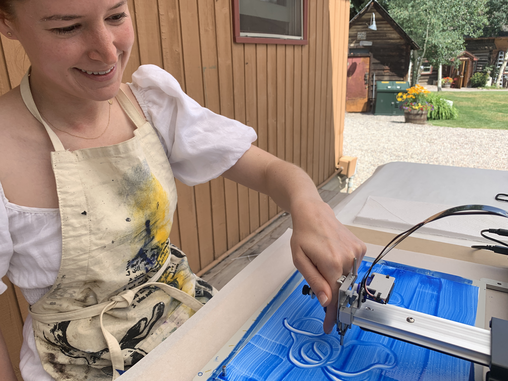
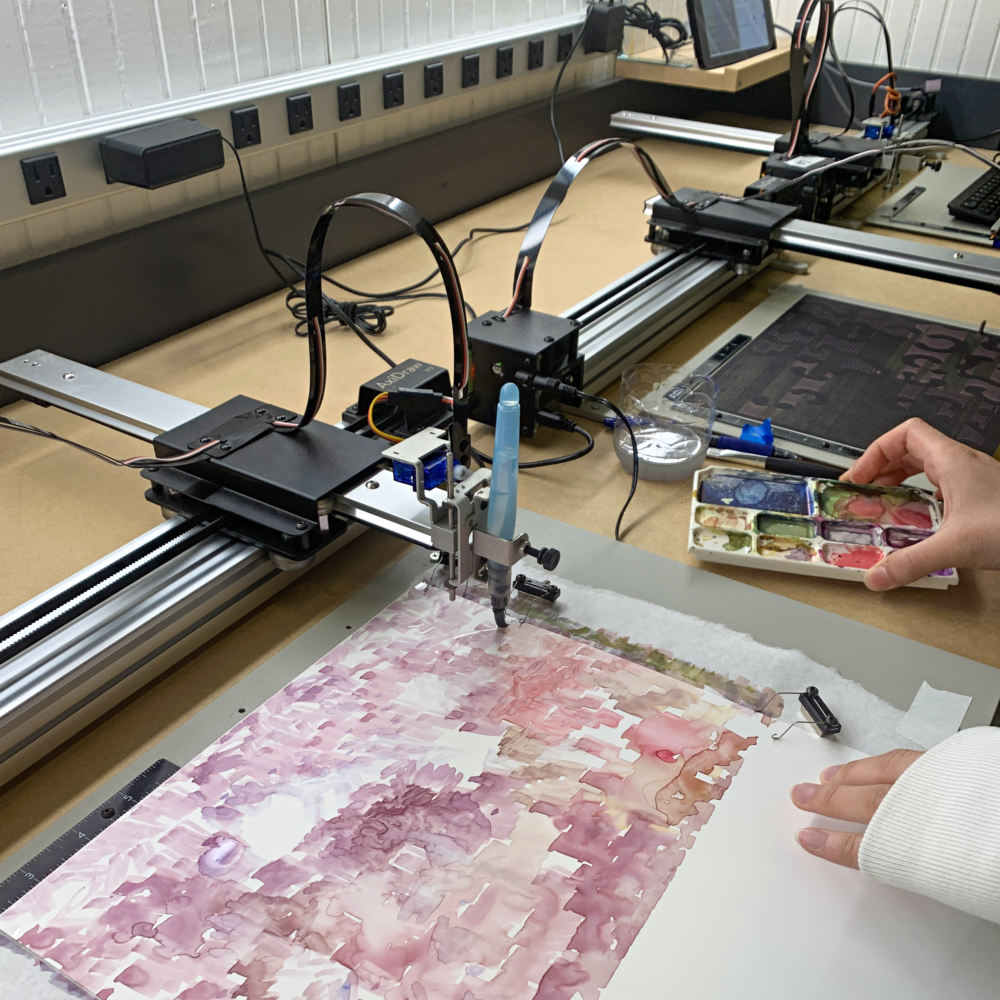
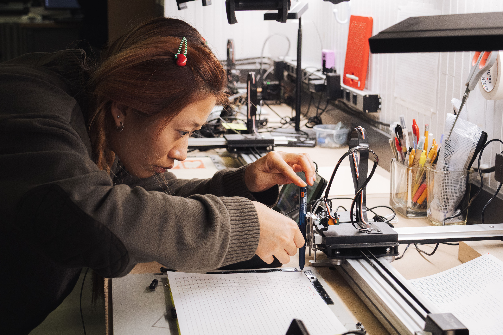
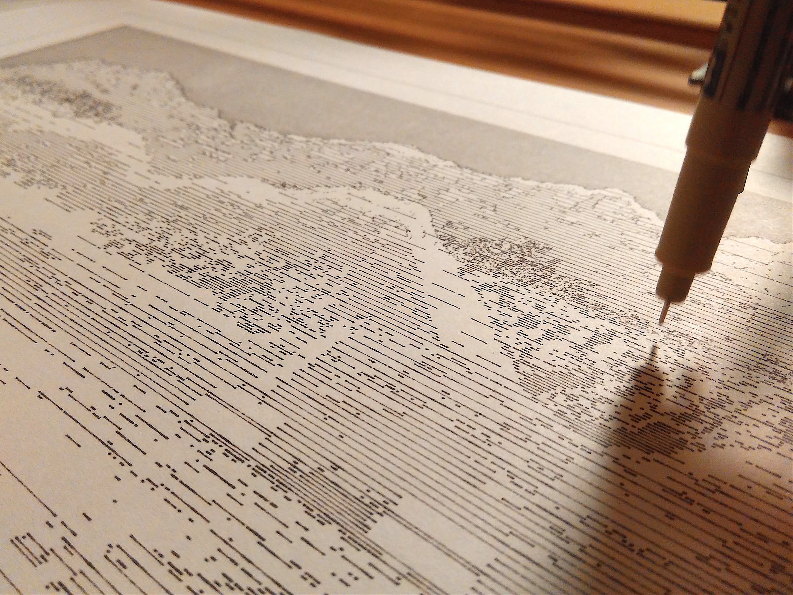
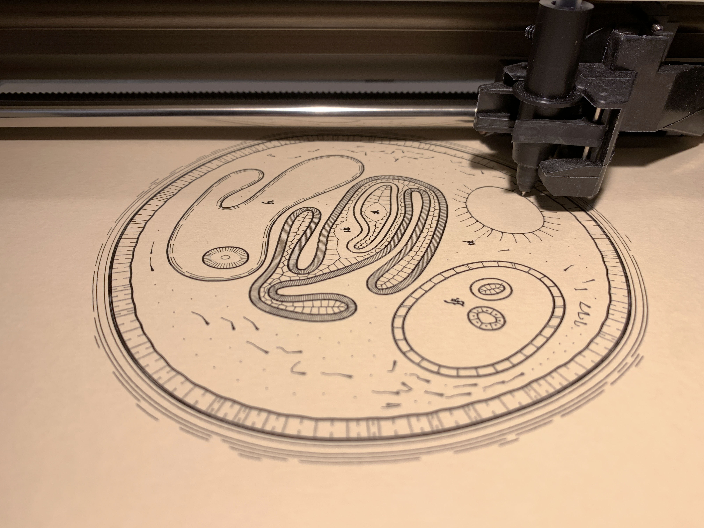

# Drawing with Machines: July 2027

This page is a stub for an upcoming *Drawing with Machines* workshop that will be offered from July 26-30, 2027 at Anderson Ranch, Snowmass, CO. 

---

## Drawing with Machines

> *Generative Art with Robotic Plotters and Real Materials*
>
> In this workshop, participants explore experimental drawing and generative art at the boundaries of creative code, automation, physical materials, and gestural mark-making. We will develop personal and peculiar approaches to drawing with machines, using algorithms and robotic collaborators as unconventional intermediaries between mind, hand, paper, and mark.
>
> Working with a wide range of drawing tools and materials, participants will investigate computational approaches to line, texture, tone, shape, typography, and composition; experiment with chance, rules, repetition, and generative systems; and develop ultra-niche workflows that take advantage of the particular quirks of machines and media. New units explore plotter typography and “plottimation”: stop-motion and sequential animation made with physical drawings.
>
> Participants will have access to an unusual collection of contemporary and vintage drawing machines, including Bantam Tools ArtFrame plotters, NextDraw/AxiDraw machines, WatercolorBots, EggBots, and classic HP pen plotters. We will work with both familiar and unconventional dry and wet media, emphasizing material experimentation and the discovery of techniques that produce results unlike ordinary digital printing.
>
> Some previous programming experience is helpful but no longer essential. Participants will be introduced to contemporary AI-assisted “vibe coding” techniques that make sophisticated generative algorithms surprisingly accessible, while experienced coders will have ample opportunity to develop more advanced computational systems. Our goal is to invent distinctive computational and material processes for making drawings that could not otherwise exist.

---

## About the Instructor

Golan Levin is a professor of computational and interactive new media art at Carnegie Mellon University, where he teaches courses in generative art, machine drawing, experimental capture, and audiovisual systems. Golan is a two-time TED speaker and recipient of undergraduate and graduate degrees from the MIT Media Laboratory. With Tega Brain, he is co-author of *Code as Creative Medium* (2021, MIT Press), an educator’s guide to creative coding.

--- 

## Images

